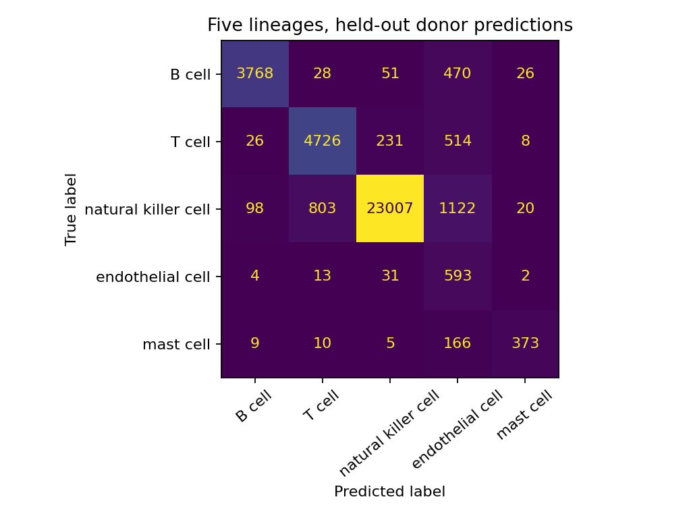

# Can frozen scGPT embeddings improve lymph node cell annotation across donors?

In a matched pilot of 360 cells from six donors, donor-averaged macro F1 was 0.814 for scGPT, 0.812 for PCA-logistic and 0.728 for markers. With only six donor folds, the 0.002 difference between the learned representations is too small to establish superiority.



## Study design

Use the LNCS slice dataset and five author-labelled lineages. Hold out one donor at a time. Compare a fixed 15-marker panel and a scaled PCA-logistic model. In the balanced pilot sample up to 12 cells per lineage and donor, freeze the whole-human encoder, bin within cells and draw up to 127 expressed vocabulary genes per cell. Load all 12 attention blocks strictly into a PyTorch CPU encoder. Fit the linear readout on training donors only.

The balanced pilot changes class prevalence. The full-data confusion matrix is for PCA-logistic. The pilot measures agreement with reference labels and uses a shorter sequence than pretraining. Overlap with pretraining donors is unknown.

## Reproduce

Use Python 3.12 from this directory in a fresh virtual environment. The analysis downloads the cited public inputs on its first run. Set `BSC_CACHE` to reuse an existing private cache. The offline tests run with the core dependencies.

```sh
python -m pip install -r requirements.txt
python -m unittest discover -v
python verify.py
python -m pip install -r requirements-model.txt
python analysis.py
python foundation.py
```

The checksum command verifies the committed release. Reruns can change benchmark timings, compressed file timestamps and rendered graphics.

## Data and results

- [Primary results](results/foundation_pilot.csv)
- [All output tables and figures](results/)
- [Input provenance and checksums](data/sources.json)
- [Protocol](docs/protocol.md)
- [Original data or method](https://www.ncbi.nlm.nih.gov/geo/query/acc.cgi?acc=GSE294959)

The MIT license covers repository code. Original datasets, model weights and structural coordinates retain the terms of their providers. Only aggregate results are redistributed here.


[Condition-specific recall](results/condition_recall.csv) gives cell counts and class recall for control and stimulated slices within each held-out donor. The CPU pilot loads the public [scGPT whole-human weights](https://github.com/bowang-lab/scGPT#pretrained-scgpt-model-zoo) into a standard PyTorch attention encoder. The [checkpoint manifest](data/checkpoint.json) records exact input hashes.
